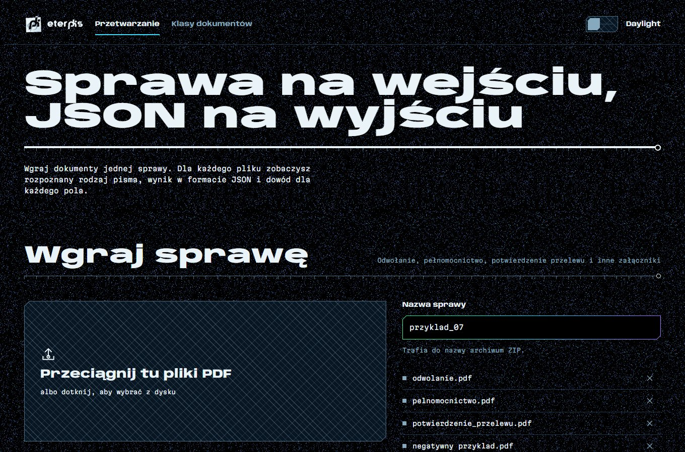
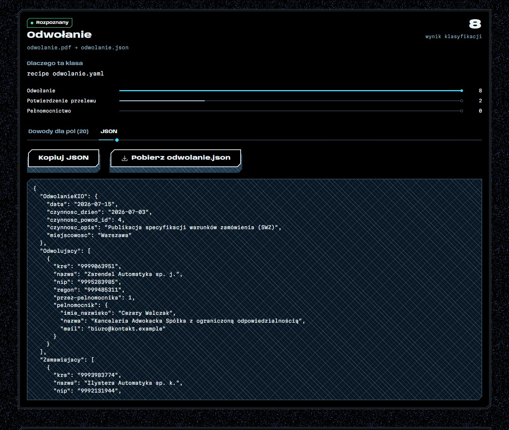
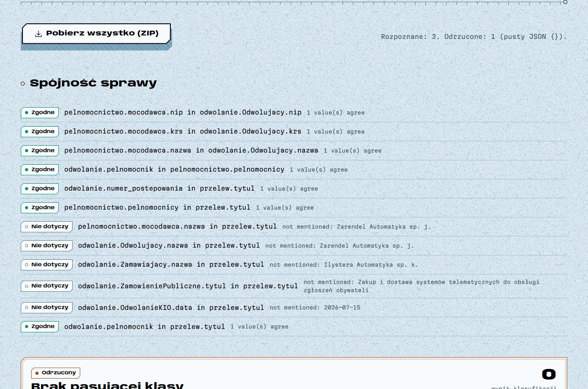
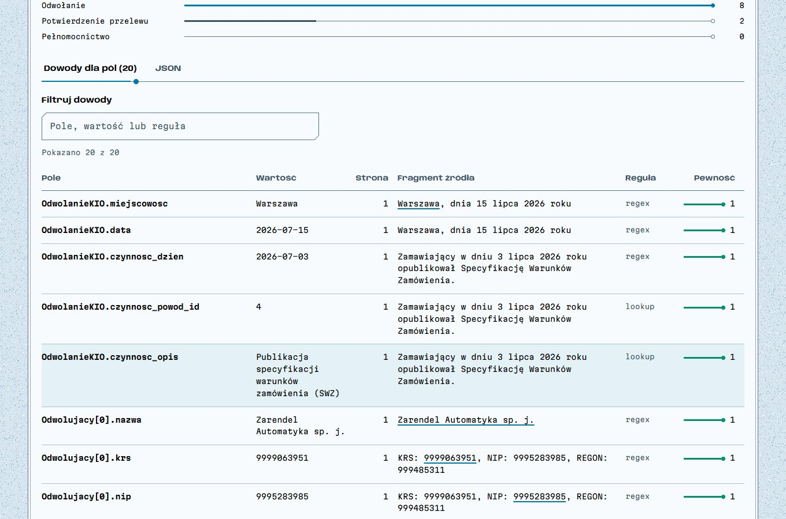
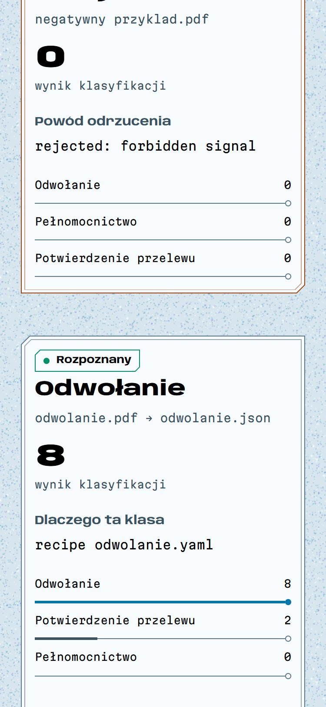

# Ślad: od dokumentów do danych

**Ślad** zamienia sprawę odwoławczą KIO, czyli PDF-y odwołania, pełnomocnictwa i potwierdzenia przelewu, w pliki JSON zgodne
z modelem Urzędu Zamówień Publicznych. Rozpoznaje rodzaj dokumentu po treści, odrzuca dokumenty spoza tych klas,
wyciąga dane i przy każdej wartości zostawia ślad w dokumencie: stronę, fragment tekstu, regułę i pewność.
Pakiet Pythona nazywa się `odw2json` (`python -m odw2json`).

- **Lokalnie, na CPU:** dane nie opuszczają komputera. Domyślna ścieżka nie używa żadnego modelu językowego.
- **Skany też:** strony bez warstwy tekstowej czyta OCR (RapidOCR, ONNX); linie zaszumione przebitką z drugiej strony
  kartki są czytane drugi raz po oczyszczeniu obrazu.
- **Nowy typ dokumentu = plik YAML,** bez programowania, także z interfejsu webowego:
  [docs/ADDING_A_DOCUMENT_CLASS.md](docs/ADDING_A_DOCUMENT_CLASS.md).
- **Spójność sprawy:** po ekstrakcji porównuje dokumenty tej samej sprawy (np. NIP mocodawcy z NIP-em Odwołującego,
  numer postępowania w tytule przelewu) i pokazuje wynik. Wartości w JSON-ie zostają takie, jak w dokumencie.
- **Opcjonalnie lokalny LLM:** profil `llm` dokłada mały model (Qwen3-1.7B, Apache-2.0, CPU) tylko dla pól, których
  reguły nie odczytały: [docs/LLM.md](docs/LLM.md).
- Projekt na HackNation 2026 (wyzwanie UZP „Odwołania2json”).

## Szybki start

Wejście: `input/<sprawa>/*.pdf`. Wyjście: `output/<sprawa>/<nazwa_pdf>.json`. Dokument odrzucony dostaje plik z pustym
JSON-em `{}` (inne tryby: `--rejected-json empty|none`).

### Windows (Python 3.13)
```
start.bat            :: przetwarza .\input -> .\output (pierwsze uruchomienie tworzy .venv i instaluje zależności)
start.bat web        :: interfejs w przeglądarce: http://127.0.0.1:8000
```

### Docker
```
docker compose up --build              # interfejs: http://localhost:8000
docker compose run --rm cli            # .\input -> .\output
```

### Python (dowolny system)
```
python -m venv .venv && . .venv/bin/activate      # Windows: .venv\Scripts\activate
pip install -r requirements.txt
python -m odw2json --input input --output output  # --recipes <katalog> dla własnych receptur
python -m odw2json --profile text --workers 4      # profil i liczba procesów, patrz docs/PROFILES.md
python -m web --port 8000                         # interfejs webowy
```

Domyślnie działa profil `ocr` na `min(4, rdzenie / 2)` procesach. Profil `llm` przy pierwszym uruchomieniu pobiera
wagi modelu (1,8 GB, suma kontrolna sha256): `python -m odw2json --profile llm` albo wcześniej
`python -m odw2json.llm.fetch`.

## Co dostaje użytkownik
| Klasa dokumentu | Najważniejsze pola |
|---|---|
| Odwołanie do KIO | data i miejscowość, zaskarżona czynność (kod 1–12 i dzień), Odwołujący (nazwa, KRS, NIP, REGON, pełnomocnik), Zamawiający, numer BZP/TED, numer i tytuł postępowania |
| Pełnomocnictwo | mocodawcy (także konsorcjum), osoby podpisujące, pełnomocnicy |
| Potwierdzenie przelewu | kwota, data, rachunki, numer transakcji, tytuł |

Nazwa pliku wynikowego to nazwa PDF-u, klasa wynika wyłącznie z treści. Format i komplet pól: `schemas/*.json`
(zgodne z `oczekiwane-json` UZP). Pole, którego nie ma w dokumencie, ma wartość `null`. Sprawa może zawierać kilka
dokumentów tej samej klasy (np. dwa pełnomocnictwa) i dokumenty spoza klas; każdy PDF jest przetwarzany osobno.

Interfejs webowy pozwala wgrać PDF-y sprawy i pokazuje dla każdego pliku klasę z punktacją, JSON, tabelę dowodów
z pewnością każdego pola oraz wynik sprawdzeń spójności sprawy. Wyniki można pobrać jako ZIP o tym samym układzie co
`output/`. Zakładka „Klasy dokumentów” to edytor receptur: nowa klasa z szablonu, walidacja, próba na PDF-ie, zapis.

| | |
|---|---|
|  |  |
|  |  |



*Zrzuty z bieżącej wersji: sprawa przyklad_07 z danych UZP oraz dokument negatywny z szablonu UZP.*

## Jak mierzyliśmy jakość
Lokalny miernik `eval/score.py`: F1 na poziomie pól, dokładne porównanie wartości (opis miary w nagłówku pliku).
Zbiory z danych UZP:

| Zbiór | Do czego | F1 (profil `ocr`) | odwołanie | pełnomocnictwo | przelew |
|---|---|---|---|---|---|
| `dane/skany` (30 skanów) | główna miara, najbliżej prawdziwego testu | **0,985** | 0,994 | 0,968 | 0,982 |
| przykłady 41–60 | odłożone | 1,000 | 1,000 | 1,000* | 1,000 |
| przykłady 01–40 | strojenie reguł | 1,000 | 1,000 | 1,000 | 1,000 |
| `dane/negatywne` (12) | odrzucanie | 12/12 dokumentów dostaje `{}` | | | |

\* Układ pełnomocnictw z 41–60 był oglądany przy strojeniu, więc ten wynik traktujemy jako zawyżony.
Skany nie są już w pełni niezależne: ogólne reguły (PESEL pełnomocnika, koniec sekcji Odwołującego, scalanie
duplikatów osób, druga próba OCR na zaszumionych liniach) powstały z analizy pomyłek na tych 30 dokumentach, a słownik
polskich znaków zawiera też słowa ze skanów. Prawdziwy test UZP ma zmieniony układ, więc spodziewamy się wyniku niższego.
Znane pomyłki na skanach: przedsiębiorca jednoosobowy jako mocodawca, zniekształcony przez OCR tytuł przelewu. Prefiks
`PL` w numerze rachunku zapisujemy tak jak wzorce UZP: na skanach, jeśli jest wydrukowany; w dokumentach z warstwą
tekstową same cyfry. Prawdziwe odwołania często mają dwukolumnowy nagłówek stron (etykieta obok zawiniętej nazwy):
porządkujemy go na poziomie układu strony, sprawdzone na zanonimizowanym odwołaniu z szablonu UZP. Profil `llm` daje dziś ten sam wynik co `ocr` (reguły czytają już
pola, w których pomagał), a kosztuje 1-3 minuty na wywołanie modelu na CPU, dlatego jest
opcjonalny. Czas i pamięć: [docs/PROFILES.md](docs/PROFILES.md) (OCR na zimno ok. 6 s mediany na dokument).

```
python -m eval.score --pred output --gold <katalog z wzorcowymi JSON> --cases 41-60 --report raport.md
python -m eval.bench --profiles ocr --sets heldout,skany,negatywne --workers 1,4    # F1 + czas + RAM
```

## Dokumentacja
- [Architektura](docs/ARCHITECTURE.md): moduły, przepływ danych, decyzje, punkty rozszerzeń.
- [Profile, równoległość i pomiar kosztu](docs/PROFILES.md): `--profile`, `--workers`, `python -m eval.bench`.
- [Lokalny model językowy](docs/LLM.md): profil `llm`, co model robi i czego nigdy.
- [Dodawanie klasy dokumentu](docs/ADDING_A_DOCUMENT_CLASS.md): samouczek, edytor w interfejsie, pełny opis receptur.
- [Komponenty zewnętrzne i licencje](docs/EXTERNAL_COMPONENTS.md): wyłącznie licencje permisywne, bez AGPL/GPL.

## Licencja i dane
Dane konkursowe UZP są generowane i publiczne, ale nie są częścią repozytorium (rozmiar). Pobiera się je osobno do
`uzp-data/`, które jest wykluczone z gita.
