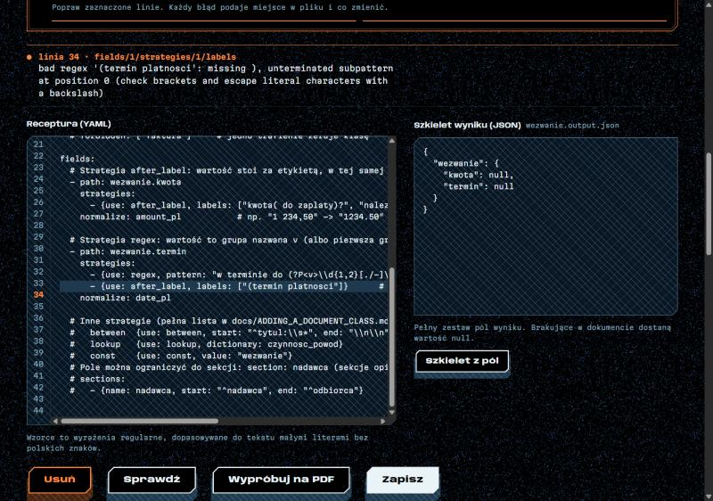
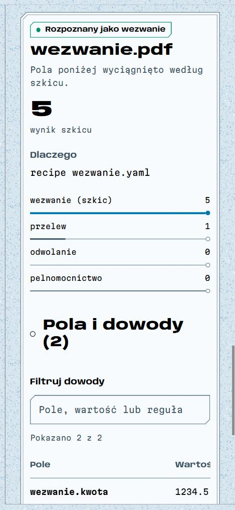

# Jak dodać nową klasę dokumentu (bez programowania)

Klasa dokumentu to jeden plik YAML w `recipes/` i, opcjonalnie, szkielet wyjściowego JSON. Silnik
(`odw2json/engine/`) nie zna żadnej klasy z nazwy: wszystko, co rozpoznaje i wyciąga, pochodzi z receptur.
Nowy lub zmieniony plik w `recipes/` silnik wczytuje przy następnym dokumencie, bez restartu (w Dockerze
`recipes/` jest zamontowany z hosta).

## Krok po kroku: klasa `faktura`

1. **Szkielet wyniku** `schemas/faktura.json` (kompletny zestaw pól; brakujące zostaną `null`):
   ```json
   {"faktura": {"numer": null, "data_wystawienia": null, "kwota_brutto": null, "nip_sprzedawcy": null}}
   ```
   Zamiast tego można podać w recepturze `output_schema: faktura.json` (ścieżka względem pliku receptury).

2. **Receptura** `recipes/faktura.yaml`. Wzorce to wyrażenia regularne Pythona dopasowywane do tekstu
   **bez polskich znaków i małymi literami** (`faktura vat`, nie `Faktura VAT`). Wartość jest wycinana z oryginału,
   więc zachowuje znaki diakrytyczne.
   ```yaml
   class: faktura
   description: Faktura VAT
   classify:
     min_score: 3          # minimum punktów, poniżej = odrzucenie
     margin: 1             # wymagana przewaga nad drugą klasą
     signals:
       - {pattern: "faktura( vat)?", weight: 3, head: 300, squash: true}   # nagłówek, także "F A K T U R A"
       - {pattern: "sprzedawca", weight: 1}
       - {pattern: "do zaplaty", weight: 1}
     forbidden:
       - "faktura korygujaca"
   fields:
     - path: faktura.numer
       strategies:
         - {use: after_label, labels: ["faktura( vat)? nr", "numer faktury"], value: "[a-z0-9/.-]{3,}"}
     - path: faktura.data_wystawienia
       strategies:
         - {use: after_label, labels: ["data wystawienia"]}
       normalize: date_pl
     - path: faktura.kwota_brutto
       strategies:
         - {use: after_label, labels: ["do zaplaty", "razem brutto"], value: "\\d[\\d .]*,\\d{2}"}
       normalize: amount_pl
     - path: faktura.nip_sprzedawcy
       section: sprzedawca
       strategies:
         - {use: regex, pattern: "nip:?\\s*(?P<v>\\d{10}|\\d{3}-\\d{3}-\\d{2}-\\d{2})(?!\\d)"}
       normalize: digits
       validate: nip
   sections:
     - {name: sprzedawca, start: "^sprzedawca", end: "^nabywca"}
   ```

3. **Sprawdzenie:**
   ```
   python -c "from odw2json.engine import load_recipes; load_recipes('recipes')"   # walidacja, błąd wskazuje plik i ścieżkę JSON
   python -m odw2json --input input --output output                                  # albo start.bat
   ```
   W interfejsie webowym (`start.bat web`) widać klasę, punkty wszystkich klas i dla każdego pola: stronę,
   fragment tekstu, regułę i pewność.

4. **Pomiar jakości** (gdy są wzorcowe JSON-y): `python -m eval.score --pred output --gold <wzorce> --report raport.md`.

## Przez interfejs

Te same pliki można utworzyć bez edytora tekstu: `python -m web` (albo `start.bat web`), zakładka **Klasy dokumentów**.

1. **Nowa klasa z szablonu** wstawia komentowany szablon (`recipes/_template.yaml.example`): sygnały klasyfikacji,
   dwa pola i po jednym przykładzie każdej strategii. Zmień `class:` (małe litery, cyfry, podkreślenie) i wzorce.
   Po prawej jest szkielet wyniku (JSON), plik wskazany w `output_schema:`; **Szkielet z pól** buduje go z listy pól.
2. **Sprawdź** uruchamia ten sam walidator co silnik. Błąd ma linię i ścieżkę w pliku (np.
   `linia 34 · fields/1/strategies/1/labels`, zły wzorzec regularny, nieznany normalizator, brakujący słownik);
   kliknięcie błędu ustawia kursor w tej linii, numer linii w marginesie świeci na miedziano.
3. **Wypróbuj na PDF** wysyła szkic i wybrane pliki PDF na serwer i pokazuje, bez zapisywania: wyniki wszystkich klas
   (razem ze szkicem), tabelę pól z dowodem (strona, fragment, reguła, pewność) i JSON. Pola wyciągane są też wtedy,
   gdy wygrała inna klasa, żeby można było poprawić sygnały.
4. **Zapisz** zapisuje `recipes/<klasa>.yaml` (atomowo; poprzednia wersja zostaje jako `<klasa>.yaml.bak`) oraz plik
   szkieletu. Następny wgrany dokument i `python -m odw2json` używają nowej klasy bez restartu. **Usuń** (z
   potwierdzeniem) przenosi plik do `<klasa>.yaml.bak`; trzech klas zadania UZP (`odwolanie`, `pelnomocnictwo`,
   `przelew`) nie można usunąć z interfejsu.




Na serwerze demonstracyjnym ustaw `ODW2JSON_READONLY_RECIPES=1`: lista, podgląd, sprawdzanie i próba działają,
zapis i usuwanie zwracają komunikat „tylko do odczytu". Te same operacje są w API (`GET /api/recipes`,
`GET /api/recipes/{nazwa}`, `POST /api/recipes/validate`, `POST /api/recipes/try`, `PUT` i `DELETE /api/recipes/{nazwa}`).

## Słowniki
`dictionaries/<nazwa>.yaml`: `entries: [{id, label, triggers: [...]}]`. Strategia `lookup` zwraca wpis, którego
fraza (wyrażenie regularne, spacja = dowolny odstęp) występuje w zakresie **najwcześniej**. Przykład:
`dictionaries/czynnosc_powod.yaml` (kody czynności Zamawiającego 1–11).

### Słownik polskich znaków (`restore_diacritics`)
`dictionaries/polish_words.txt` to lista poprawnych polskich wyrazów, po jednym w wierszu. Plik powstaje skryptem
`python dictionaries/build_polish_words.py <uzp-data/dane>` z wartości w publicznych wzorcowych JSON-ach
(`przyklad_*`, `skany`) oraz ręcznej listy `dictionaries/polish_words.extra.txt` (słownictwo dziedzinowe); wyraz
zostaje, tylko gdy jego pisownia bez ogonków nie występuje sama w źródłach. Dopisanie wyrazu = dopisanie go do
`polish_words.extra.txt` i ponowne uruchomienie skryptu.

## Dokumentacja receptury
Pełna, formalna definicja: `recipes/recipe.schema.json` (walidowana przy wczytaniu).

### Klasyfikacja (`classify`)
| Klucz | Znaczenie |
|---|---|
| `signals` | lista `{pattern, weight, head, squash}`; punkty = suma wag trafionych sygnałów |
| `head: N` | szukaj tylko w pierwszych N znakach (tekst ze ściśniętymi odstępami) |
| `squash: true` | dopasuj po usunięciu wszystkich odstępów (nagłówki rozstrzelone, OCR bez spacji) |
| `required` | wszystkie muszą wystąpić, inaczej klasa ma 0 |
| `forbidden` | dowolne trafienie daje klasie 0 (np. ogłoszenie TED zamiast odwołania) |
| `min_score`, `margin` | próg i przewaga nad drugą klasą; inaczej dokument jest odrzucany |

### Sekcje (`sections`)
`{name, start, end, within, include_start}`. Zakres od pierwszego `start` do najbliższego `end` (domyślnie do końca
dokumentu lub sekcji nadrzędnej `within`). Pole z `section:` jest szukane tylko w tym zakresie. Jeśli sekcji nie ma,
pole jest pomijane.

### Pola (`fields`)
| Klucz | Znaczenie |
|---|---|
| `path` | ścieżka w wyniku z kropkami (`a.b.c`); `lista[].pole` z `all: true` = każda wartość to element listy |
| `strategies` | lista prób w kolejności; wygrywa pierwszy kandydat, który przejdzie normalizację |
| `normalize` | nazwa lub lista normalizatorów (poniżej) |
| `validate` | walidator sumy kontrolnej; niezgodność obniża pewność do 0,5, wartość zostaje |
| `dedupe` | `{fuzzy: N}` na polu listy (`lista[].pole` z `all: true` albo lista scalana przez `list_of_blocks.merge`): scala elementy, które wskazują tę samą osobę. Imiona są takie same po zwinięciu wielkości liter i polskich znaków albo różnią się o najwyżej `fuzzy` znaków (domyślnie `fuzzy: 0`: samo zwinięcie, które łączy `Zawadżki` / `Zawadzki` i `JAN KOWALSKI` / `Jan Kowalski`; `fuzzy: 1` zlałoby też różne osoby, np. `Kowalski` / `Kowalska`, więc receptury go nie używają). Zostaje zapis z małymi literami zamiast WERSALIKÓW, a przy remisie późniejszy (podpis) |
| `attach_to`, `window` | pole `lista[].pole` z `attach_to: lista[].klucz`: wartość drukowana obok każdego elementu już odczytanej listy, szukana osobno dla każdego elementu w tekście za jego wystąpieniem, do wystąpienia następnego elementu (najwyżej `window` znaków, domyślnie 200). Przykład: PESEL każdego pełnomocnika. Gdy imię występuje kilka razy (np. w nagłówku kancelarii), liczy się pierwsze wystąpienie, po którym jest wartość |
| `list_of_blocks` + `fields` | lista obiektów: każdy `start` otwiera blok (opcjonalnie `end`, `max`), pola zagnieżdżone liczone w bloku |

Kilka wpisów o tej samej ścieżce wykonuje się po kolei, a późniejszy nadpisuje wcześniejszy, jeśli znajdzie wartość.
Daje to regułę ogólną z precyzyjną regułą na wierzchu.

### Strategie (`use:`)
| Strategia | Klucze | Co robi |
|---|---|---|
| `regex` | `pattern`, `all`, `raw`, `nth` | dopasowanie wzorca; wartość to grupa `v` (albo grupa 1, albo całe dopasowanie); `raw: true` = z wielkością liter na oryginalnym tekście; `nth: N` = tylko N-te różne trafienie (0 pierwsze, -1 ostatnie), np. rachunek nadawcy, potem odbiorcy |
| `after_label` | `labels`, `value`, `max_lines`, `below` | wartość na prawo od etykiety (do przerwy kolumnowej) albo w linii pod etykietą w tej samej kolumnie (siatki bankowe); `value` = wymagany kształt wartości |
| `between` | `start`, `end` | tekst między dwoma wzorcami (domyślnie do pustej linii), łączy przeniesienia wierszy |
| `lookup` | `dictionary`, `return` | wpis słownika z najwcześniej występującą frazą; zwraca `id` (lub `label`, ...) |
| `const` | `value` | stała |
| `derived` | `if_set`, `value`, `else` | `value`, gdy pole `if_set` jest ustawione, inaczej `else` |
| `segments` | `value`, `exclude`, `not_after`, `raw` | wartości w kolumnach linii (np. podpisy pod kropkami); `raw: true` = dopasowanie z wielkością liter |

Każda strategia może mieć `section: <nazwa>`: szuka wtedy tylko w tej sekcji receptury (jedno pole: najpierw wzorzec z całego dokumentu, potem z sekcji; gdy sekcji nie ma, strategia jest pomijana).

`list_of_blocks` dostaje `min_blocks` (mniej początków bloków niż N = jeden blok na
cały zakres, np. jeden mocodawca zamiast konsorcjum) i `merge` (bloki dołączane po kolei do istniejącej listy, np.
grupy podpisów „W imieniu X:” do mocodawców).

### Normalizatory (`normalize:`)
| Nazwa | Wynik |
|---|---|
| `date_pl` | data ISO z `12.03.2026`, `12 marca 2026`, `2026-03-12`, `12.III.2026` |
| `amount_pl` | liczba z `1 234,56 zł`, `1.234,56`, `17.00` |
| `digits` | same cyfry |
| `int` | liczba całkowita |
| `iban_pl` | 26 cyfr rachunku bez `PL` i spacji |
| `iban_pl_as_printed` | jak `iban_pl`, ale na stronie ze skanu (OCR) zachowuje wydrukowany prefiks `PL` (`PL62…`); ze strony z warstwą tekstową zawsze same cyfry. Normalizator „świadomy strony”: dostaje źródło strony (`text`/`ocr`) |
| `ted` | numer TED jako `NNNNNN-RRRR` (także z `RRRR/S NNN-NNNNNN`) |
| `bzp` | numer BZP bez spacji |
| `strip` | pojedyncze spacje, bez przecinków/dwukropków na brzegach |
| `unquote` | jak `strip` i bez cudzysłowów |
| `upper`, `title` | wielkie litery / każde słowo wielką literą |
| `person` | imię i nazwisko; zapis WERSALIKAMI zamieniony na „Jan Kowalski-Nowak”; sklejone słowa „HalinaBaran” → „Halina Baran” (obie części wielką literą i co najmniej 2 litery; tylko tu, nazwy firm jak `BudMax` zostają) |
| `company` | nazwa firmy z poprawką typowych błędów OCR w formie prawnej („Sp. z 0.o.” → „Sp. z o.o.”) |
| `ocr_text` | tekst po OCR: litery z tyldą (Ñ → Ń) i dwukropek w numerze sprawy zamiast kropki (`DA.ZP:242.13.2026`) |
| `restore_diacritics` | przywraca polskie znaki wyrazom ze słownika `dictionaries/polish_words.txt` (zachowuje wielkość liter, naprawia też złe akcenty: „Lódź” → „Łódź”; wyrazów niejednoznacznych i nieznanych nie rusza) |
| `flag` | 1, gdy fraza-znacznik została znaleziona (treść dopasowania jest bez znaczenia) |
| `ocr_digits` | cyfry identyfikatora po OCR: `o`/`O` → 0, `l`/`I` → 1 |

### Walidatory (`validate:`)
`nip`, `regon` (9 lub 14 cyfr), `pesel`, `krs` (10 cyfr), `iban` (mod 97).

### Własne rozszerzenia (programista)
`register_strategy`, `register_normaliser`, `register_validator` w `odw2json/engine/`. Nowa nazwa staje się
dostępna w YAML. Test `tests/test_docs_recipe_reference.py` pilnuje, żeby każda zarejestrowana nazwa była opisana tutaj.

### Czytelnik LLM (`llm:`, opcjonalny)
Receptura może poprosić lokalny mały model (profil `llm`, opis w [LLM.md](LLM.md)) o pola, których reguły nie odczytały.
Bez profilu `llm` blok jest ignorowany, a wynik się nie zmienia. Zasady: model przepisuje tekst tak, jak jest wydrukowany,
normalizatory z receptury robią z niego wartość, każda wartość musi mieć cytat znaleziony w tekście strony, a wartości
odczytanej przez regułę z pełną pewnością model nigdy nie nadpisuje.

```yaml
fields:
  - path: faktura.numer
    strategies: [...]
    llm: {question: "Numer faktury, tak jak jest wydrukowany.", hint: "Nie numer zamówienia."}   # pole z receptury
llm:                                       # blok klasy: pola po ścieżce w JSON-ie wyjściowym, listy, kontekst
  context: {pages: 2, max_chars: 4500}     # co widzi model (domyślnie 2 strony, 6000 znaków)
  fields:
    - path: faktura.rodzaj
      type: integer
      question: "Jaki to rodzaj faktury?"
      choices: {dictionary: rodzaje}       # model wybiera id ze słownika (albo lista {id, label})
      also: {path: faktura.rodzaj_opis, key: label}   # ustaw też drugie pole z wybranego wpisu
    - path: faktura.nip_nabywcy
      question: "NIP nabywcy."
      normalize: digits
      validate: nip
      when: "nabywca"                      # regex na tekście bez diakrytyków: pytaj tylko, gdy pasuje (oszczędza czas)
  groups:                                  # lista osób/stron: element dopasowany po polu `key`
    - path: strony
      key: nazwa
      question: "Strony umowy."
      fields:
        - {path: nazwa, question: "Pełna nazwa."}
        - {path: pesel, question: "PESEL.", normalize: digits, validate: pesel}
```
Opcje pola: `question`, `hint`, `type` (`string`/`integer`), `choices`, `override` (domyślnie `false`: pole wypełniane
tylko gdy puste albo o niskiej pewności; `true` pozwala też zastąpić odczyt OCR o pewności poniżej 1,0), `when`,
`section` (pokaż modelowi tylko tę sekcję receptury), `also`. W kodzie silnika i w `odw2json/llm/` nie ma nazw klas.
