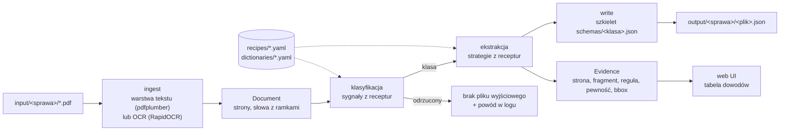

# Architektura odw2json

odw2json zamienia sprawę odwoławczą KIO (folder z plikami PDF: odwołanie, pełnomocnictwo, potwierdzenie
przelewu) na pliki JSON zgodne z modelem UZP (`uzp-data/oczekiwane-json`). Działa lokalnie, na CPU, bez usług
zewnętrznych i bez modeli językowych.

## Przepływ

## Moduły

| Moduł | Rola |
|---|---|
| `odw2json/model.py` | Kontrakt między modułami: `Word`, `Page`, `Document`, `Classification`, `Evidence`, `Extraction` oraz protokoły `Ingestor`, `Classifier`, `Extractor`. |
| `odw2json/ingest/` | `pdf.py`: tekst i słowa z ramkami z warstwy tekstowej PDF (pdfplumber). Strony bez tekstu idą do OCR (`ocr.py`, domyślnie RapidOCR na ONNX Runtime, render stron przez pypdfium2). `layout.py` składa słowa w linie i bloki w kolejności czytania. |
| `odw2json/engine/` | `RecipeEngine`: klasyfikator i ekstraktor sterowany wyłącznie plikami receptur. `recipes.py` wczytuje i waliduje YAML (`recipes/recipe.schema.json`), `strategies.py` zawiera strategie wyszukiwania wartości, `normalise.py` normalizatory i walidatory, a `text.py` udostępnia tekst bez polskich znaków z zachowaniem przesunięć. |
| `odw2json/pipeline.py`, `cli.py` | Przetwarza `input/<sprawa>/*.pdf` i zapisuje `output/<sprawa>/<nazwa>.json` (dokument odrzucony dostaje `{}`). `--workers N`: pula procesów po dokumentach, wynik identyczny jak przy 1. |
| `odw2json/profiles.py`, `profiles/*.yaml` | Profile przetwarzania (`text`, `ocr`; miejsce na `llm`): który ingestor i które opcje buduje fabryka. Opis: [PROFILES.md](PROFILES.md). |
| `odw2json/write.py` | Uzupełnia wynik szkieletem `schemas/<klasa>.json` (brakujące pola = `null`) i zapisuje JSON (UTF-8). |
| `odw2json/factory.py` | Domyślne komponenty: ingestor (wg profilu) i jeden współdzielony `RecipeEngine`. Tu się podmienia implementacje. |
| `recipes/`, `dictionaries/` | Konfiguracja klas dokumentów: sygnały klasyfikacji, sekcje, pola i strategie, słowniki kodów (np. `czynnosc_powod`). |
| `schemas/` | Szkielety wyjściowego JSON dla każdej klasy (kolejność i komplet pól jak u UZP). |
| `web/` | FastAPI + statyczny interfejs (identyfikacja Cold Trace). Pozwala wgrać PDF-y sprawy i zobaczyć klasę, wynik, JSON i tabelę dowodów z pewnością każdego pola, a także pobrać ZIP. |
| `eval/` | `score.py`: lokalna miara F1 na poziomie pól (dokładna i znormalizowana), raport najgorszych pól; `make_noisy.py`: zaszumione skany do testu odporności OCR. |

## Model danych
`Document` → `Page` (numer, wymiary, `words` z ramkami i pewnością OCR, `text`, `source`: `text` albo `ocr`).
Klasyfikator zwraca `Classification` (klasa albo `None` = odrzucenie, punkty wszystkich klas, powód).
Ekstraktor zwraca `Extraction`: `data` (JSON zgodny ze schematem) i listę `Evidence` (ścieżka pola jak w wyniku, np.
`Odwolujacy[0].nip`, wartość, strona, fragment tekstu, nazwa strategii, pewność, ramka na stronie).

## Decyzje projektowe
- **Bez LLM jako podstawa (D-005).** Reguły są deterministyczne, przejrzyste i działają offline na CPU. Każda
  wartość ma dowód: stronę, fragment i regułę. LLM może najwyżej dodać coś na wierzchu, nigdy nie jest warunkiem
  działania.
- **Nowa klasa = konfiguracja, nie kod.** W `odw2json/engine/` nie ma nazw klas (test akceptacyjny to sprawdza grepem).
  Nowy plik YAML w `recipes/` to nowa klasa, którą silnik podchwytuje bez restartu. Opis kroków:
  [ADDING_A_DOCUMENT_CLASS.md](ADDING_A_DOCUMENT_CLASS.md).
- **Odrzucanie zamiast zgadywania.** Dokument, który nie pasuje do żadnej receptury (za mało punktów, sygnał
  zakazany, zbyt mała przewaga nad drugą klasą), nie dostaje pliku JSON.
- **Pewność pola.** Wynosi 1,0. Spada do 0,5, gdy nie przechodzi suma kontrolna (NIP, REGON, PESEL, IBAN), a na stronach
  z OCR jest mnożona przez 0,9. Wartość nigdy nie jest usuwana, tylko oznaczana.

## Punkty rozszerzeń
- **Silnik OCR:** `register_backend("nazwa", factory)` w `odw2json/ingest/ocr.py`, wybór przez `ODW2JSON_OCR`.
- **Strategie, normalizatory, walidatory:** `register_strategy` / `register_normaliser` / `register_validator`
  (rejestry w `odw2json/engine/`), potem użycie nazwy w YAML.
- **Inny klasyfikator lub ekstraktor:** implementacja protokołu z `model.py` i podpięcie w `factory.py`
  (np. planowany klasyfikator Basal/LLM jako druga opinia; *planowane*).
- **Spójność dokumentów w sprawie** (np. ten sam wykonawca w odwołaniu i pełnomocnictwie): *planowane* (T009).

## Konfiguracja przez zmienne środowiskowe
| Zmienna | Domyślnie | Znaczenie |
|---|---|---|
| `ODW2JSON_RECIPES` | `./recipes` | katalog receptur (CLI: `--recipes`) |
| `ODW2JSON_DICTIONARIES` | `./dictionaries` | katalog słowników |
| `ODW2JSON_OCR` | `rapidocr` | silnik OCR |
